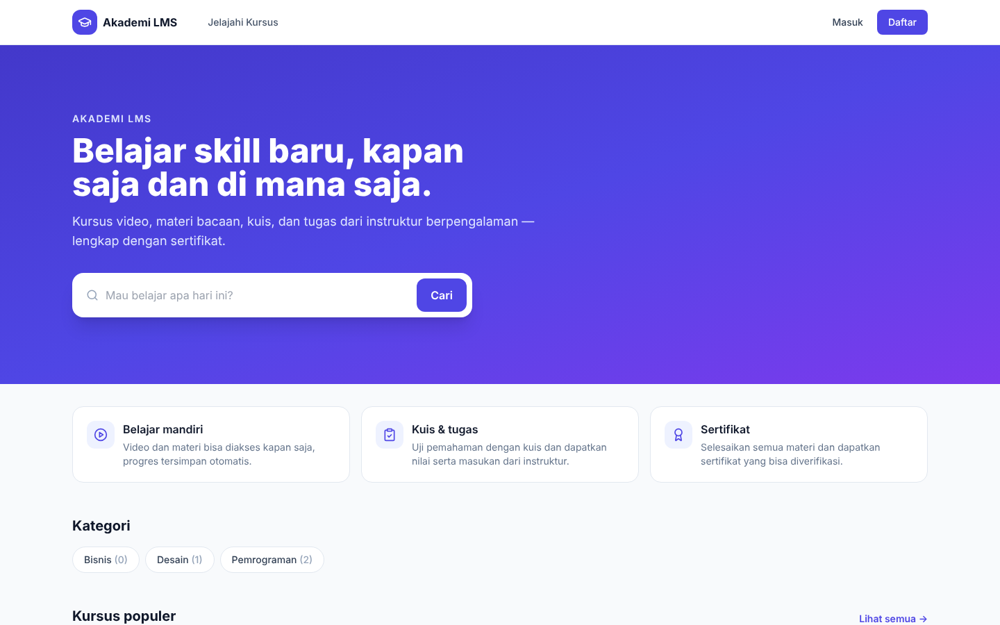
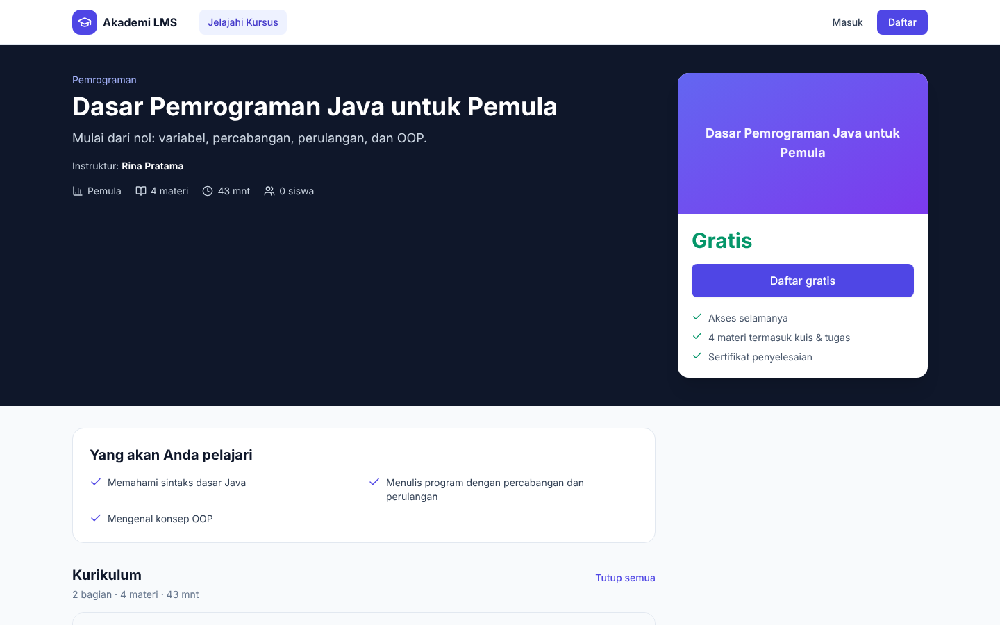
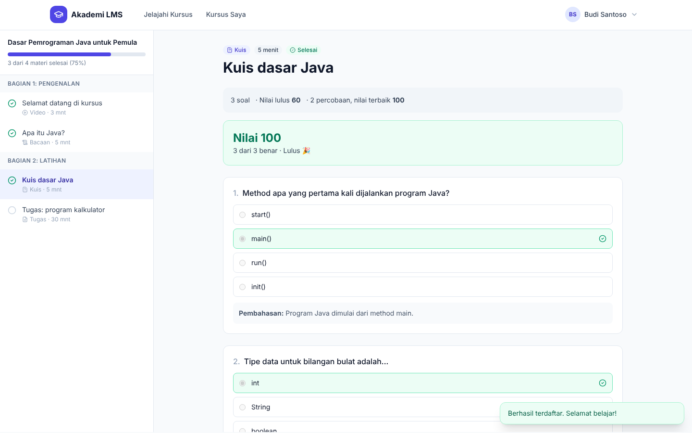
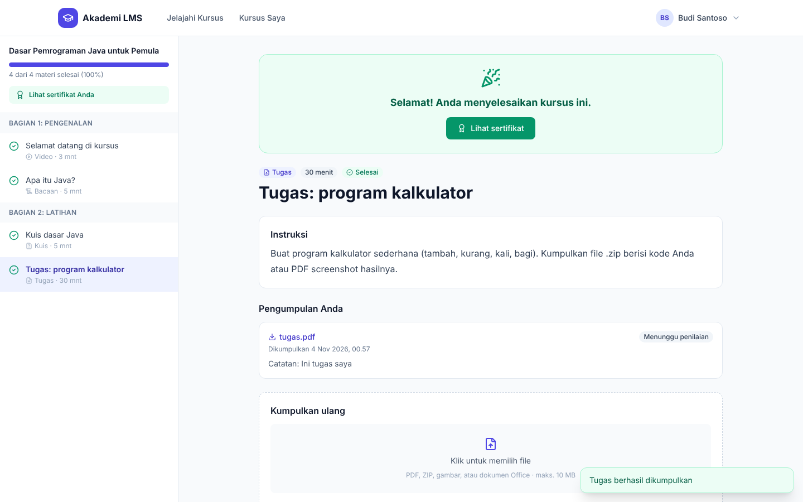
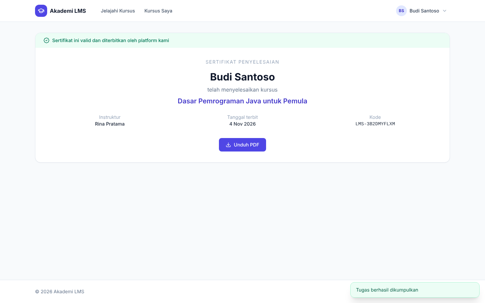
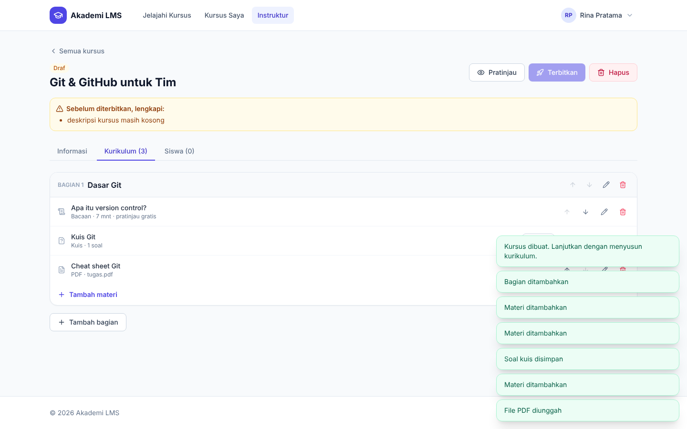
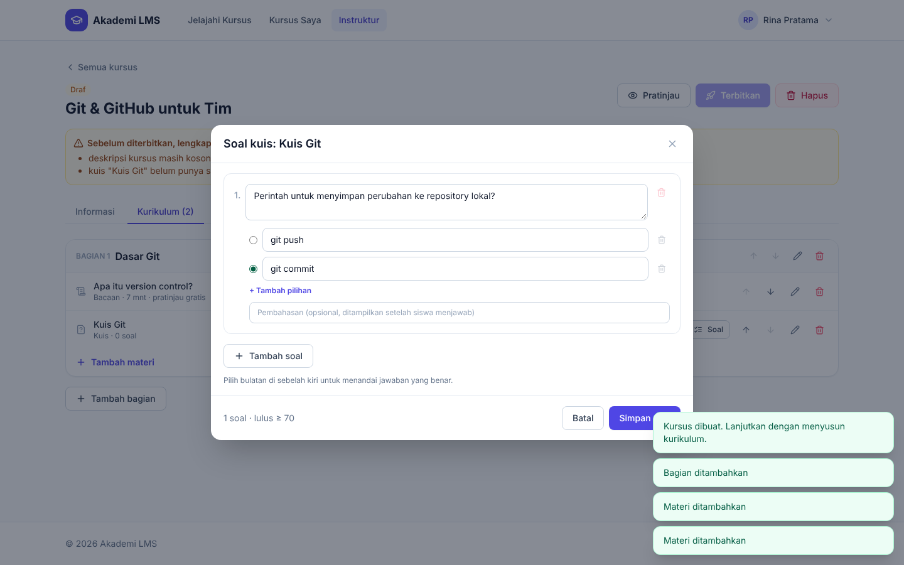

# Akademi LMS

Learning Management System untuk kursus online: katalog kursus publik, belajar dengan video/bacaan/PDF, kuis dengan penilaian otomatis, tugas dengan penilaian instruktur, pembayaran Midtrans, dan sertifikat yang bisa diverifikasi.



## Fitur

**Siswa**
- Katalog dengan pencarian, filter kategori/level/harga, dan pengurutan
- Halaman kursus: kurikulum, "yang akan dipelajari", profil instruktur, **pratinjau gratis**
- Daftar kursus gratis atau **beli kursus berbayar** (Midtrans Snap; simulator untuk development)
- Ruang belajar: daftar materi + progres, video (YouTube/Vimeo/Google Drive/MP4), bacaan Markdown, PDF, **kuis** (nilai otomatis, pembahasan, coba ulang), **tugas** (upload file, nilai & masukan instruktur)
- Kursus selesai otomatis → **sertifikat PDF** dengan kode verifikasi publik
- Kursus Saya, Sertifikat, Riwayat Pembelian, Pengaturan Akun

**Instruktur**
- Dasbor: kursus, siswa, pendapatan, tugas menunggu dinilai
- Editor kursus: informasi, gambar sampul, harga, kategori, level
- Kurikulum: bagian & materi (tambah/ubah/hapus/urutkan), editor Markdown dengan pratinjau, unggah PDF, **editor soal kuis**
- Pemeriksaan sebelum terbit, terbitkan/jadikan draf/arsipkan, pratinjau sebagai siswa
- Daftar siswa per kursus beserta progres, penilaian tugas

**Admin**
- Ringkasan platform, pengguna (ubah peran / nonaktifkan), semua pesanan, kategori

**Keamanan**: JWT, role-based access, kunci jawaban kuis tidak pernah dikirim ke browser sebelum dijawab, konten Markdown disanitasi, file divalidasi berdasarkan isinya (magic bytes), notifikasi Midtrans diverifikasi signature + dicek ulang ke API Midtrans.

## Stack
- Backend: Java 21, Spring Boot 3.3, Spring Security (JWT), JPA, Flyway, PostgreSQL 16, PDFBox
- Frontend: React 18, Vite, TypeScript, Tailwind CSS, React Router
- Infra: Docker Compose (Nginx menyajikan frontend & mem-proxy `/api`), GitHub Actions

## Menjalankan dengan Docker (paling mudah)

```bash
cp .env.example .env      # untuk mencoba lokal, isi APP_SEED_DEMO=true dan APP_PAYMENT_SIMULATOR=true
docker compose up -d --build
```

Buka **http://localhost:8082**.

| Akun | Password | Peran |
|------|----------|-------|
| `admin@lms.local` (atau `APP_ADMIN_EMAIL`) | `admin12345` (atau `APP_ADMIN_PASSWORD`) | Admin |
| `instruktur@lms.local` | `instruktur123` | Instruktur (data demo) |
| `siswa@lms.local` | `siswa12345` | Siswa (data demo) |

Port bawaan dipilih agar tidak bentrok dengan aplikasi lain: frontend **8082**, backend **8081**, PostgreSQL **5434**.

## Mode development

```bash
docker compose up -d postgres            # PostgreSQL di localhost:5434

cd backend
./mvnw spring-boot:run                   # Windows: mvnw.cmd spring-boot:run  → http://localhost:8080

cd frontend
npm install
npm run dev                              # → http://localhost:5173
```

Swagger UI: http://localhost:8080/swagger-ui.html

## Pembayaran (Midtrans)

- Tanpa `MIDTRANS_SERVER_KEY` dan dengan `APP_PAYMENT_SIMULATOR=true`, tombol **Beli kursus** membuka halaman simulasi (tanpa uang sungguhan).
- Untuk pembayaran sungguhan: isi `MIDTRANS_SERVER_KEY` (sandbox atau production), set `MIDTRANS_PRODUCTION`, matikan simulator, set `APP_FRONTEND_URL` ke domain publik, lalu di dashboard Midtrans atur **Payment Notification URL** ke `https://DOMAIN-ANDA/api/payments/midtrans/notification`.

## Konfigurasi backend

| Variabel | Default | Keterangan |
|----------|---------|------------|
| `SPRING_DATASOURCE_URL` / `_USERNAME` / `_PASSWORD` | `localhost:5434/lms` | Koneksi PostgreSQL (skema dikelola Flyway) |
| `JWT_SECRET` | dev secret | ≥ 32 byte, **wajib diganti** |
| `APP_FRONTEND_URL` | `http://localhost:5173` | URL publik frontend untuk redirect pembayaran |
| `APP_ADMIN_EMAIL` / `APP_ADMIN_PASSWORD` | `admin@lms.local` / `admin12345` | Admin pertama |
| `APP_SEED_DEMO` | `true` | Data demo; set `false` di production |
| `APP_ALLOW_INSTRUCTOR_SIGNUP` | `true` | Izinkan daftar sebagai instruktur |
| `APP_PAYMENT_SIMULATOR` | `true` | Simulator pembayaran (development) |
| `MIDTRANS_SERVER_KEY` / `MIDTRANS_PRODUCTION` | kosong / `false` | Midtrans Snap |
| `APP_UPLOAD_DIR` | `./uploads` | Penyimpanan sampul, PDF materi, file tugas (Docker: volume `uploads_data`) |

## Testing

```bash
cd backend && ./mvnw test     # integration test (H2) + test pembayaran Midtrans
cd frontend && npm run build  # typecheck + build
```

## Screenshot

| Halaman kursus | Kuis |
|---|---|
|  |  |
| **Kursus selesai** | **Sertifikat** |
|  |  |
| **Kurikulum (instruktur)** | **Editor kuis** |
|  |  |
